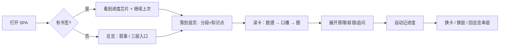
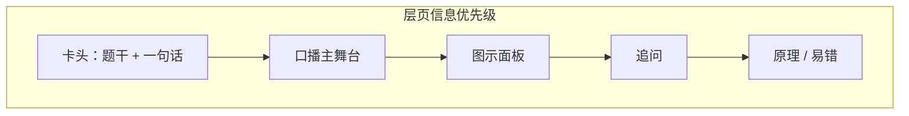

# 面试作战台 · DevOps 面试知识图谱 — 产品设计 + UI/UX 设计稿

> **状态**：Phase 1–3 已交付（2026-11-04）· 琥珀 · 口播纵向 · 图示记忆 · 舒适密度 · 仅追问开 · 总览交互图 · Phase3 换卡动效 / 口播焦点 / 打印 / 本层弱进度  
> **产品**：离线 SPA · Vite + React + TS + Ant Design 5 dark · Mermaid + React Flow  
> **读者**：产品使用者 — 先选决策点，再进入实现  
> **约束不变**：离线可用、localStorage 书签 v2、hash 深链、中文内容模型不动

---

## 0. 现状快审（为什么说「直男工程师审美」）

| 维度 | 现状 | 问题感 |
|------|------|--------|
| **主题** | `darkAlgorithm` + 主色 `#3d9cf0`，表面 `#0f1419 / #141a22 / #1a222d` | 接近 Ant 默认暗色 demo，缺少「产品身份」 |
| **Layout** | 顶栏品牌字 + 横向 Menu；内容 `max-width: 1100`、padding 16 | 顶栏像后台控制台；页脚技术说明过长、抢注意力 |
| **LayerPage** | Title → Callout(Alert) → BookmarkBanner(Alert) → 三张跳转卡 → 「卡墙」标题 → Segmented → 说明文 → Select → CardView | **Alert 叠 Alert**；入口卡与主任务抢视线；「卡墙」命名偏工程 |
| **CardView** | 一句话/简历 Descriptions → DiagramPanel → Collapse 四块全展开 | 口播不是视觉主角；图夹在中间像插件；Collapse 全开 = 信息墙 |
| **Overview** | 叙事 + 书签 + 三层入口卡 + **Tag 彩虹层卡** + 交互图谱 + Steps + STAR + 冲刺 | 同构 Card/Tag 堆叠；蓝/紫/绿彩虹 Tag；图谱与静态层卡重复 |
| **DiagramPanel** | 小 Card + Tabs「图示 / 交互图谱」 | 默认插入流里，高度与节奏未一等公民化 |
| **Bookmark** | 成功色 Alert +「继续上次」 | 功能对，形态像系统通知而非「进度芯片」 |
| **字体/密度** | 15px oral、line-height 1.7；整体 `size="small"` + gutter 12 | 口述尚可；控件偏挤；区块节奏平 |
| **空/载** | Spin tip、无图时 Panel 直接 `null` | 无图卡无占位；加载态朴素 |
| **移动端** | Segmented 可横滑；Select 全宽；header wrap | 可用但顶栏折行后像临时站 |

**一句话诊断**：信息架构基本正确，视觉系统几乎等于「Ant 暗色默认 + 工程师填内容」——功能先于阅读体验，图示后置，口播未升为一等公民。

---

## A. 产品定位与目标用户

### 定位

**一人面试作战台**：把「语言 → 中间件 → DevOps 场景」三层知识点，做成**可离线、可续读、可口播、可图文对照**的本地 SPA。不是博客，不是 Wiki，不是通用笔记——是**冲刺期每天打开就能接着背、对照图讲清楚**的工具。

### 目标用户

- **画像**：资深 DevOps / 平台开发向候选人；Go + Python 并列主语言；K8s / CI/CD 实战深；冲 **Golang / 运维开发** 面试。
- **内容口径**：简历数字只认 **99.9999% 可用性**、**成本约 -40%**；诚实边界用 warning，不吹。
- **用法四件套**：
  1. **快速过卡** — Segmented + Select 秒切知识点  
  2. **口播背诵** — 60–90 秒口述稿为主路径  
  3. **图文对照** — Mermaid 静态 + React Flow 可拖拽  
  4. **跨天续读** — localStorage v2 分页书签 + hash 深链  

### 产品成功标准（体验向）

- 打开 3 秒内知道「上次练到哪」并一键续上。  
- 进入一张卡后，**先看到题感（一句话）→ 口播 → 图**，追问/原理可按需展开。  
- 总览用来**串层与 STAR/冲刺**，层页用来**刷卡**，职责不混。  
- 暗色下长时间阅读不刺眼、不「像公司内部工单系统」。

---

## B. 核心场景与任务流

### 主任务流



### 场景 × 现状痛点对照

| 场景 | 用户目标 | 现状摩擦 | 设计目标 |
|------|----------|----------|----------|
| 打开续读 | 立刻接着练 | 双 Alert + 长 description，像系统日志 | 顶栏旁或内容顶：**紧凑进度芯片** + 主按钮 |
| 选层/知识点 | 少点击定位 | 「卡墙」+ 入口三卡 + 说明文抢带宽 | **导航条固定**：分段 → 知识点 → 正文；跨层入口收进次要区 |
| 口播 | 大声背 60–90s | 埋在 Collapse 第三项，和原理/易错同级 | **口播升主栏**；原理/易错/追问次级 |
| 图文对照 | 边看图边讲 | Diagram 夹在 Descriptions 与 Collapse 之间，体量像附件 | **图示一等公民**：默认可视、可折叠记忆偏好 |
| 总览串层 | 讲清支撑关系 | 彩虹 Tag 卡片墙 + 交互图 + Steps 三重重复 | **一张主图谱 + 短说明**；STAR/冲刺分区清晰 |
| 跨天 | 各层进度独立 | 能力已有（v2），表达偏技术 | UI 表达「本层进度 / 全局上次」而非 localStorage 文案 |

---

## C. 信息架构

### 导航（保持 4 页，强化心智）

| 路由 | 职责 | 不该承载 |
|------|------|----------|
| `#/overview` | 主叙事、三层关系图谱、STAR、冲刺计划、全局「继续」 | 单知识点厚答 |
| `#/lang` | Go/Python 刷卡 | 冲刺日程全文 |
| `#/mid` | 中间件/基础设施刷卡 | STAR 全文 |
| `#/scene` | DevOps 场景刷卡 | 三层关系教学长文 |

顶栏建议心智：**品牌（短）| 四页导航 | 进度芯片（右侧）**。页脚瘦身：一行「离线 · 进度仅本机」即可，技术细节进 README。

### 卡片区块优先级（层页 · 单卡）

**建议阅读顺序（P0 → P3）**：

1. **P0 题感头**：知识点标题 + 一句话 +（可选）简历锚点一行  
2. **P0 口播区**：60–90 秒口述 — **主舞台**，大字号、舒适行宽、左侧强调条  
3. **P0/P1 图示区**：知识图示（Mermaid / 交互）— 与口播同级或紧随其后  
4. **P1 追问**：面试高压路径，默认可展开前 2 条或整块默认开  
5. **P2 原理 / 易错**：备查，默认折叠或「精简展开」  
6. **P3 诚实边界 warning**：有则置顶色条，短、不挡口播  

**关联**：跨层链接从「三张大卡」降为卡片底「相关层」文字链或轻 chip，避免每页重复门户。

### 总览 vs 层页分工

```
总览 = 地图 + 剧本 + 日程
层页 = 训练场（一张卡练透）
```

- 总览：**一个**交互主图谱（可缩放）+ 极简层说明；去掉彩虹小卡墙或收成图谱图例。  
- 层页：去掉重复「本页定位」大段 Alert（改为页眉一行副标题）；书签用芯片。

---

## D. UI/UX 专项优化方向

### D1. 视觉系统提案名：**「Night Briefing」**（夜间简报 / 面试作战台）

专业、沉静、略偏产品，而不是运维监控大盘，也不是彩虹标签墙。

#### 色彩（精炼暗色层级 · 1 强调 + 语义色）

| Token | 建议值 | 用途 |
|-------|--------|------|
| `bg.canvas` | `#0B0F14` | 页面底 |
| `bg.elevated` | `#121821` | 顶栏 / 抬起表面 |
| `bg.card` | `#161E29` | 主卡片 |
| `bg.oral` | `#0F1A17` 或极淡 accent 罩 | 口播舞台 |
| `border.subtle` | `rgba(255,255,255,0.06)` | 分割 |
| `border.strong` | `rgba(255,255,255,0.12)` | 聚焦卡片 |
| **accent** | 候选见 §G | 链接、选中、进度、主按钮 |
| `success` | `#3DB88A` | 口播强调 / 已续读 |
| `warn` | `#D4A017` | 诚实边界（非彩虹） |
| `text.primary` | `#E8EEF4` | 标题/正文 |
| `text.secondary` | `#8B9BB0` | 说明 |
| `text.muted` | `#667788` | 元信息 |

**避免**：蓝/紫/绿彩虹 Tag 标三层；多色 Tag 堆冲刺日。层身份用**左侧 3px 色条或单一中性 Tag + 数字①②③**。

#### 字体与口播行宽

| 角色 | 建议 |
|------|------|
| 页标题 | 22–24px / semibold，字重分明 |
| 卡标题 | 18px |
| 正文 | 15px，`line-height: 1.65–1.75` |
| **口播** | **16–17px**，`line-height: 1.8`，`max-width: 42–48rem`（舒适朗读） |
| 代码/标识 | `ui-monospace` / JetBrains Mono 栈，13px |
| 字体栈 | 保持中文优先：`PingFang SC` / `Noto Sans SC` + system-ui |

#### 间距与密度

- 区块垂直节奏：**24 / 32**（主区块），控件组内 **12**；告别处处 `size="small"` + gutter 12 的「表格感」。  
- 主内容区：`max-width: 960–1040px`（口播友好）；图示区可 **breakout** 到 `min(100%, 1120px)`。  
- 卡片内边距：16–20；口播区 20–24。  
- Segmented / Select：**粘性工具条**（吸顶在顶栏下），减少滚回重选。

#### 组件抛光

| 组件 | 方向 |
|------|------|
| **Segmented** | 圆角 10、选中态用 accent 底 + 清晰字重；过长组保持横滑但加边缘渐隐 |
| **Select** | 全宽至工具条内；选中项展示「组名 · 卡名」 |
| **Tabs（图示）** | 线型或 pill；图标+短文案「流程」「可交互」 |
| **Bookmark chip** | 非 Alert：胶囊条 = 标签文案 + 相对时间 +「继续」；空态一行提示 |
| **进度** | 可选：本层已浏览卡数弱提示（不强制做完整进度条，Phase 1 芯片即可） |
| **Callout** | 自定义左边线面板，少用 Ant Alert 默认皮肤 |
| **Collapse** | 原理/易错默认收起；追问默认开（见决策点） |

#### 动效（克制）

- 换卡：口播区与图示 **120–180ms fade/slide**，不整页闪。  
- 图示面板展开：height + opacity；React Flow **fitView** 在 tab 显时触发一次。  
- 禁止大面积弹跳、彩屑、无关 skeleton 狂欢。

#### 无障碍

- 正文与底对比 ≥ 4.5:1；口播区单独验一遍。  
- 焦点环：`accent` 外描 2px，勿 `outline: none`。  
- Segmented/Select/「继续」可键盘操作；图示提供「跳过图谱」锚点到追问。

### D2. 布局线框

#### 总览 Overview

```
┌─────────────────────────────────────────────────────────┐
│ 品牌短名          [总览][语言][中间件][场景]    [进度芯片] │
├─────────────────────────────────────────────────────────┤
│ 主叙事（1 短段，无 Alert 壳）                              │
│ ┌──────────┐ ┌──────────┐ ┌──────────┐                  │
│ │ ①语言层  │ │ ②中间件  │ │ ③场景    │  ← 轻入口，非彩虹 │
│ └──────────┘ └──────────┘ └──────────┘                  │
│                                                         │
│ 三层关系                                                 │
│ ┌─────────────────────────────────────────────────────┐ │
│ │         React Flow 主图谱（一等公民，更高）            │ │
│ │         图例：支撑 / 构建（短）                        │ │
│ └─────────────────────────────────────────────────────┘ │
│                                                         │
│ STAR 剧本          │  冲刺 3/5 天                         │
│ [项目 Select]      │  [Segmented]                         │
│ 角色+层映射        │  日卡片（中性边框，无彩虹 Tag）       │
│ S/T/A/R 口播块     │  清单 ☐                               │
└─────────────────────────────────────────────────────────┘
```

#### 层页 Layer + 卡详情

```
┌─────────────────────────────────────────────────────────┐
│ …顶栏同…                                       [进度芯片] │
├─────────────────────────────────────────────────────────┤
│ ①语言层 · Golang / Python          副标题一行（定位）     │
│ ┌─ sticky 工具条 ─────────────────────────────────────┐ │
│ │ [ Golang | Python | … Segmented ]                   │ │
│ │ [ 知识点 Select                              ▾ ]    │ │
│ └─────────────────────────────────────────────────────┘ │
│                                                         │
│ ┌ 卡头 ───────────────────────────────────────────────┐ │
│ │ channel / select                                     │ │
│ │ 一句话 … · 简历锚点（次级一行）                        │ │
│ └─────────────────────────────────────────────────────┘ │
│                                                         │
│ ┌ 口播（主舞台）──────────────────────────────────────┐ │
│ │ ▎ 60–90 秒口述                                       │ │
│ │   …大字号 oral…                                      │ │
│ └─────────────────────────────────────────────────────┘ │
│                                                         │
│ ┌ 图示（可折叠，默认见 §G）────────────────────────────┐ │
│ │ [流程 | 可交互]   适应宽度 / 全高约 360–420           │ │
│ └─────────────────────────────────────────────────────┘ │
│                                                         │
│ ▶ 追问 (n)     ▼ 默认开或前几条                           │
│ ▶ 原理 (n)     ▷ 默认关                                   │
│ ▶ 易错 (n)     ▷ 默认关                                   │
│                                                         │
│ 相关：总览 · 中间件 · 场景（文字链）                       │
└─────────────────────────────────────────────────────────┘
```



---

## E. 设计原则与「不做」清单

### 原则（7 条）

1. **口播优先**：任何布局争论，先服务 60–90 秒朗读。  
2. **图示一等公民**：有 visuals 的卡，图不是附录。  
3. **一层视觉身份**：深色层级靠表面与边框，不靠彩虹标签。  
4. **续读无摩擦**：进度永远可见、可点，但不刷屏。  
5. **总览地图 / 层页训练场**：职责分离，避免每页复制门户。  
6. **克制动效**：只服务「换卡、展开、适配画布」。  
7. **离线诚实**：不引入必须在线的字体/图标 CDN；不改书签协议。

### 「不做」清单

- ❌ 不做亮色主题切换（本阶段）  
- ❌ 不做账号云同步 / 后端  
- ❌ 不改中文内容模型与卡字段语义  
- ❌ 不做花哨 3D / 粒子 / 重仪表盘  
- ❌ 不用多色 Tag 表达三层身份  
- ❌ 不把原理列表做成默认长页墙  
- ❌ 不为「好看」牺牲 hash 深链与 v2 书签  
- ❌ 不强制每张卡都有图（无图则优雅隐藏，不 Empty 尴尬占位也可，见决策）

---

## F. 分期交付建议

### Phase 1 — 视觉系统 + 卡片层级（Must · 建议先做）

- Token 化颜色/圆角/间距；替换 Alert 书签为 **进度芯片**；Callout 重做。  
- CardView 重排：**口播升主**；原理/易错默认折叠；追问策略按确认项。  
- LayerPage：粘性 Segmented+Select；弱化入口三卡；去「卡墙」工程命名。  
- Overview：去掉彩虹 Tag 墙或降为图例；主图谱加大；STAR/冲刺分区视觉分离。  
- 页脚瘦身；顶栏进度。  
- **验收**：你主观觉得「能拿去给面试官旁边的自己看」而不是「内部 wiki」。

### Phase 2 — 图示 UX + 总览图谱抛光

- DiagramPanel：默认开/关记忆（localStorage 小键，与 bookmark 分离）；tab 切换 fitView。  
- Mermaid 主题色对齐 Night Briefing；Flow 节点样式统一（少默认白边）。  
- OverviewFlow：层着色克制、边标签可读、移动端高度策略。  
- 无图卡：可选「本卡暂无图」弱提示（非 Empty 插画）。

### Phase 3 — 微交互 / 打印 / 弱进度（已交付）

- ✅ 换卡口播/图示 **150–160ms** fade-slide；`prefers-reduced-motion` 关闭。  
- ✅ **今日口播**焦点模式：层页工具条切换；隐主导航与页脚；顶栏「退出焦点 · Esc」；写入 `devops-kg-ui-prefs.focusMode`。  
- ✅ `@media print` 白底：保留卡题 + 一句话 + 口播；隐藏导航/芯片/图示/追问折叠。  
- ✅ 本层已浏览卡数弱进度条（`visitedByPage`，工具条底部细轨）。

---

## G. 待你确认的决策点（实现前请勾选）

### 1. 强调色 vibe（选一）

| 选项 | 色感 | 适合 |
|------|------|------|
| **A. 雾蓝（接近现状升级）** | `#4C9AE8` → 更干净的蓝 | 改动最小、稳妥 |
| **B. 青绿（推荐）** | `#2EB8A6` | 区分「又一个蓝后台」，偏产品、护眼 |
| **C. 琥珀** | `#E6A23C` | 更「作战/冲刺」情绪，偏醒目 |

**你的选择**：☑ C 琥珀 `#E6A23C`

### 2. 单卡布局（选一）

| 选项 | 结构 |
|------|------|
| **A. 纵向堆叠（推荐）** | 头 → 口播 → 图 → 折叠块；一条滚轴，适合口播 |
| **B. 页签式** | 「口播 | 图示 | 备查」Tabs；桌面干净，口播与图不能同屏对照 |
| **C. 桌面分栏** | 左口播 / 右图（≥1200px），移动仍堆叠；实现成本高 |

**你的选择**：☑ A 纵向堆叠

### 3. 图示面板默认状态（选一）

| 选项 | 行为 |
|------|------|
| **A. 默认展开** | 有图就显示（图文对照优先） |
| **B. 默认折叠** | 点开再看（先背口播） |
| **C. 记住上次** | localStorage 记展开偏好（推荐作 Phase 2，Phase 1 可先 A 或 B） |

**你的选择**：☑ C 记住上次（`devops-kg-ui-prefs`）

### 4. 信息密度（选一）

| 选项 | 表现 |
|------|------|
| **A. Comfortable（推荐）** | 更大口播字号、区块间距 24–32、少 small 控件 |
| **B. Compact** | 更接近现状，多卡一屏，偏「工程师列表」 |

**你的选择**：☑ A Comfortable

### 5. 原理 / 易错 / 追问默认展开（可多选策略）

| 选项 | 策略 |
|------|------|
| **A. 仅追问默认开**（推荐） | 原理+易错关 |
| **B. 追问+易错开** | 原理关 |
| **C. 全关，手动开** | 最干净，备查成本略高 |
| **D. 维持现状全开** | 不推荐 |

**你的选择**：☑ A 仅追问默认开

### 6. 总览「三层静态卡墙」怎么处理（选一）

| 选项 | 行为 |
|------|------|
| **A. 删除静态卡墙，只留交互图谱 + 短说明**（推荐） | 去重、降彩虹 |
| **B. 保留极简图例条，不要逐节点小卡** | 折中 |
| **C. 保留现状卡墙 + 图谱** | 信息重复 |

**你的选择**：☑ A 删除静态卡墙，只留交互图谱

---

## 附录：实现时注意（确认后交给工程）

- 主题集中改 `main.tsx` ConfigProvider tokens + `index.css` 变量；组件少写魔法色。  
- 书签 UI 重做但 **读写仍走 `bookmark.ts` v2**；若加图示展开偏好，用独立 key，例如 `devops-kg-ui-prefs`。  
- 不引入必须联网的字体包；图标继续 `@ant-design/icons` 即可。  
- 确认 §G 后再动 `CardView` / `LayerPage` / `OverviewPage` / `BookmarkBanner` / `DiagramPanel`。

---

*设计稿版本：2026-11-04 · Night Briefing · Phase 1–3 已落地*
